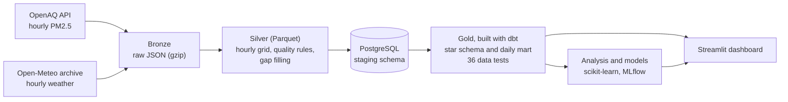
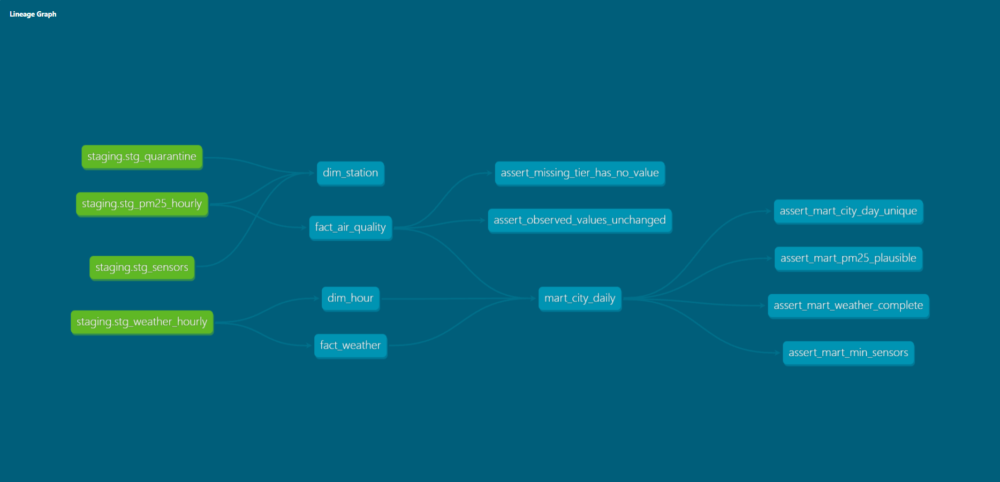
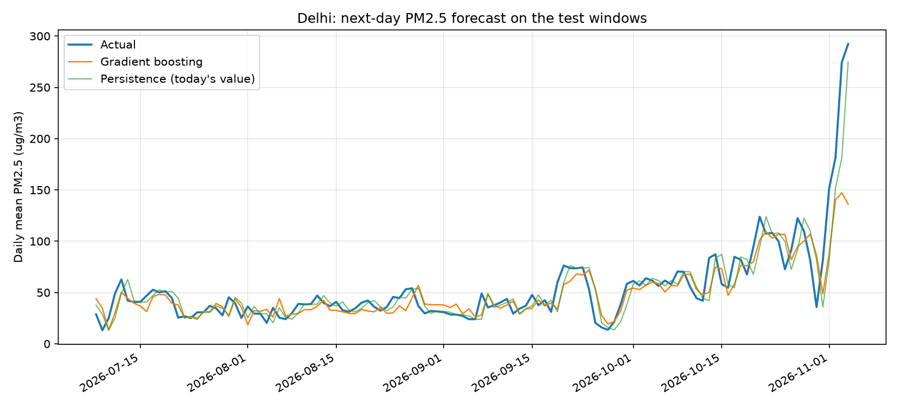
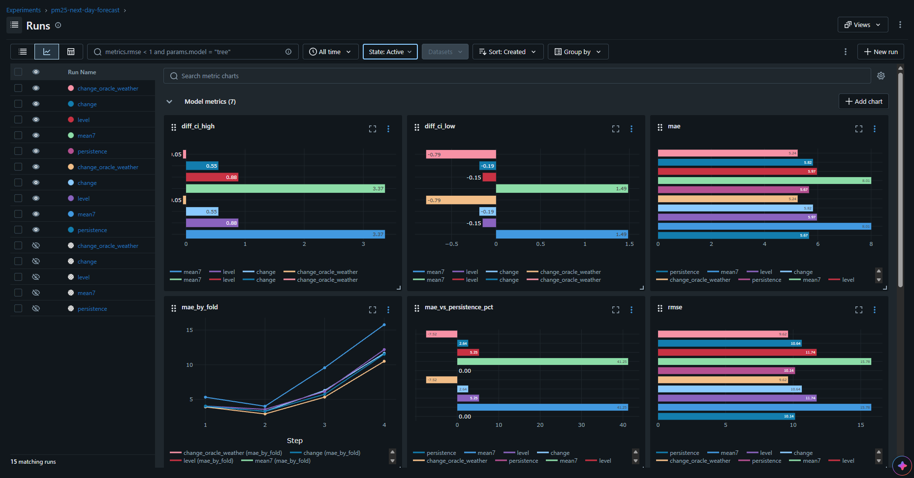
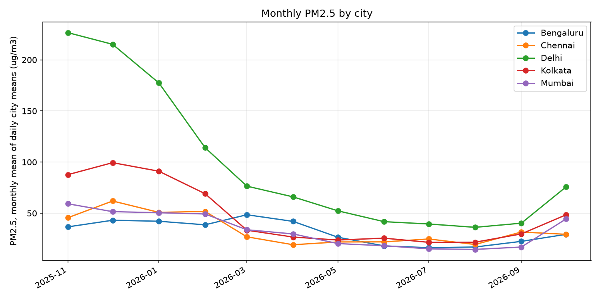
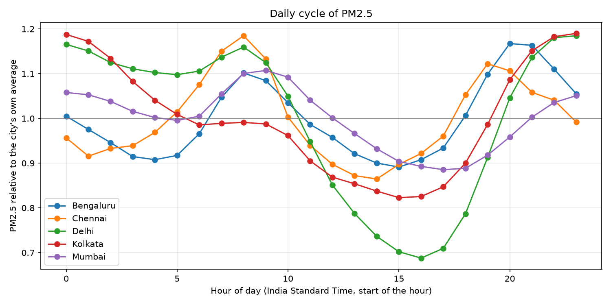
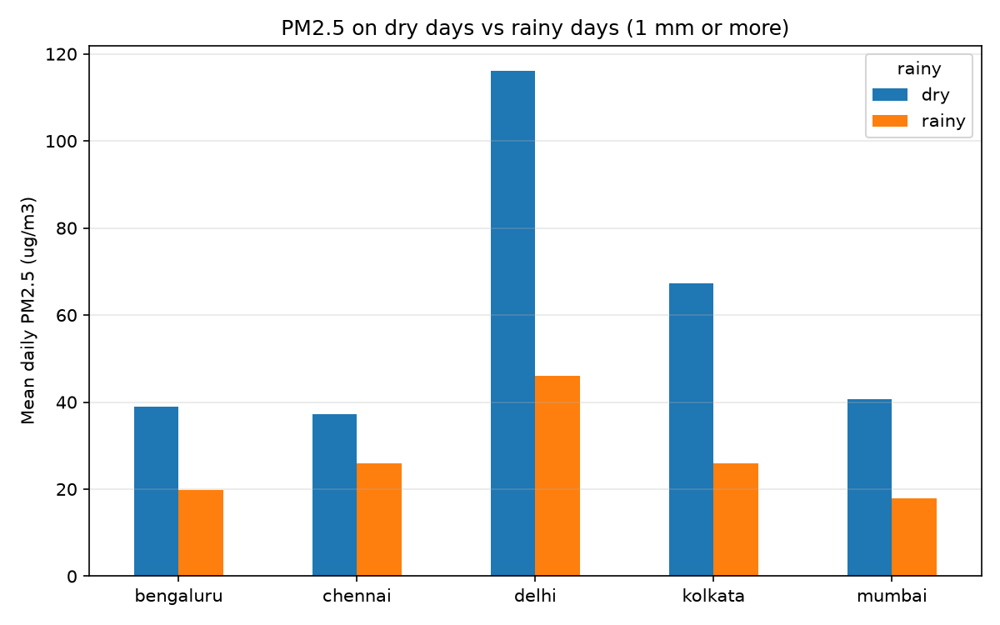
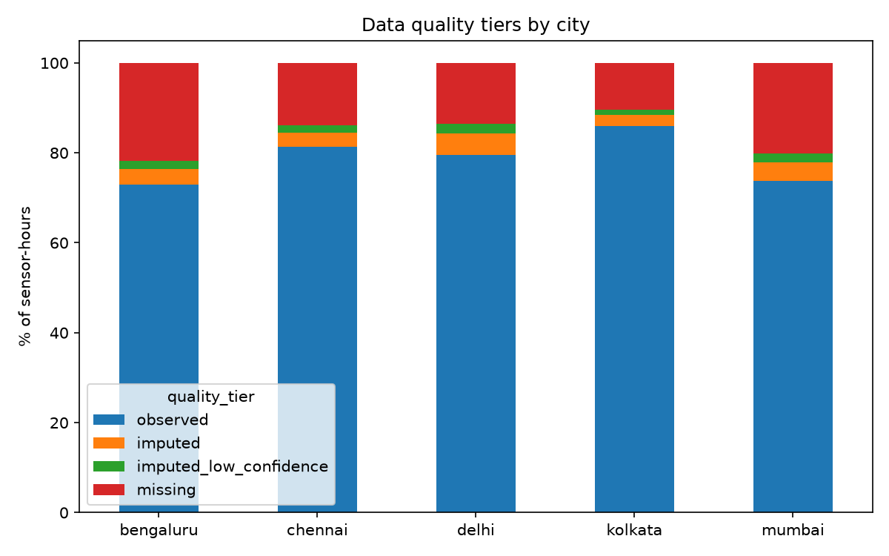

# Air Quality Intelligence Platform


An end-to-end data platform for air quality in five Indian cities (Delhi, Mumbai, Kolkata, Bengaluru, Chennai). It downloads hourly PM2.5 readings from OpenAQ and hourly weather from Open-Meteo, cleans them with explicit quality rules, models a PostgreSQL warehouse with dbt, analyses the data, forecasts next-day PM2.5 with tracked experiments, and serves the results in a dashboard.

**Live dashboard:** [open the dashboard](https://air-quality-india-aq.streamlit.app) (a static snapshot, see Limitations)

## Highlights
- **A clear seasonal signal:** Delhi's monthly mean PM2.5 was about six times higher in November 2025 than in August 2026, and the same winter-high, monsoon-low pattern shows in four other cities.
- **12 months of hourly data** (Nov 2025 to Nov 2026): about 860,000 PM2.5 readings from 124 stations, plus hourly weather for each city.
- **Real-world data problems found and handled**: half-hour timestamp offsets, frozen sensors, duplicate sensors, and a city average distorted by a single sensor (details below).
- **Data quality is explicit**: every reading removed by a rule is kept in a quarantine table with the reason, and every filled hour carries a quality tier.
- **Warehouse with tests**: a star schema built with dbt, with 36 automated data tests.
- **Honest modelling**: forecasts are compared with a "tomorrow equals today" baseline on rolling time-based test windows, with bootstrap error bars. Most models do not clearly beat the baseline, and the project says so.

## Architecture



| Layer | What it holds | Where |
|---|---|---|
| Bronze | API responses saved untouched, with the request and a timestamp | `data/bronze/` (not committed) |
| Silver | One row per sensor and hour on a complete grid, with quality flags and imputation labels | `data/silver/` (not committed) |
| Staging | The silver tables loaded into PostgreSQL | schema `staging` |
| Gold | Dimensions, two fact tables and a daily city mart | schema `gold`, built by `dbt_project/` |

## Data sources

- **Air quality:** [OpenAQ](https://openaq.org) API v3 (free key). Hourly PM2.5 for every station with an active PM2.5 sensor within 25 km of each city centre.
- **Weather:** [Open-Meteo](https://open-meteo.com) historical weather API (CC BY 4.0, non-commercial use): temperature, humidity, pressure, precipitation and wind, at one grid point per city. This is gridded model data, not station measurements.

## Engineering problems found and how they were handled

| Problem | What was found | Handling |
|---|---|---|
| Half-hour timestamps | All 124 sensors report hourly buckets that start at :30 UTC (India is UTC+5:30), so a naive UTC grid silently dropped rows | Each sensor gets its own grid. The bucket that straddles the start of the window is trimmed deliberately (102 rows) and counted. Any other off-grid row is written to a file, and the run stops if they exceed 0.1% of rows. |
| Duplicate sensors | 75 of 199 PM2.5 sensors returned no data for the whole year; each station has one reporting sensor | Only sensors that return data enter the silver layer |
| Frozen sensor | One Chennai sensor repeated a few fixed values for most of the year | A flat-run rule plus a dead-sensor rule removes it entirely, with a record of why |
| A city mean driven by one sensor | On six Mumbai days only one sensor reported, which lifted Mumbai's mean from 44.7 to 67.2 ug/m3 | City days need at least 3 sensors, and a dbt test enforces it |
| API limits and timeouts | Long date ranges need pagination, and some sensors time out on a full year | Resumable downloads, atomic file writes, and a fallback that requests the window in smaller chunks |
| Tooling | MinIO's public Docker images were no longer available, and dbt, MLflow and Streamlit have different dependency needs on Python 3.14 | The lake is plain local files, and each tool has its own virtual environment |

## Data quality

Five rules run on the silver table. Flagged readings are set to missing in the cleaned copy and listed in `pm25_quarantine.csv`.

| Rule | Flags a reading when |
|---|---|
| range | below 0 or above 1000 ug/m3 |
| zero | exactly 0 |
| flat | 6 or more identical consecutive hourly values from a sensor |
| spike | above 300 and above 4 times the city median for that hour, with at least 3 sensors reporting |
| dead sensor | more than half of a sensor's readings are already flagged |

- **15,140 of 859,134 observed readings (1.76%) were quarantined.** Across full months the share stayed between 1.1% and 3.0%, with no jump in the winter months. About half of the quarantined readings belong to the one frozen Chennai sensor.
- **The spike rule compares each reading with the city median for the same hour**, so citywide smog episodes are kept while single-sensor spikes are removed (the largest removed value was 418,000 ug/m3).
- **Gap filling was benchmarked by hiding known values** and measuring the error of each method. Gaps of 1 to 2 hours use linear interpolation, 3 to 12 hours use an interpolation anchored to the city average, 13 to 24 hours use a scaled city average (kept as a separate low-confidence tier), and longer gaps are left empty. The thresholds were tuned on one month of data.
- **Every hour carries a quality tier:** `observed`, `imputed`, `imputed_low_confidence` or `missing`.

## Warehouse

Built with dbt (core 1.12, PostgreSQL adapter 1.11), run against PostgreSQL 16 in Docker.

- `dim_city`, `dim_station`, `dim_hour` (with India Standard Time columns)
- `fact_air_quality` (one row per sensor and hour, with the quality tier), `fact_weather` (one row per city and hour)
- `mart_city_daily` (one row per city and day, with daily weather)
- 36 data tests: keys, relationships, accepted values, and custom tests such as "missing hours carry no value", "observed values are unchanged" and "a city day needs at least 3 sensors"

<!-- To add after running `dbt docs serve`:  -->

## Modelling

**Task:** forecast tomorrow's daily mean PM2.5 for each city, from recent PM2.5, today's weather, the day of week and the city. Tomorrow's weather is not used, because it would not be known in advance.

**Evaluation:** four consecutive 30-day test windows (8 July to 4 November 2026), each trained only on earlier data. Errors are in ug/m3, and the mean PM2.5 in the test windows is 31.5.

| Method | MAE | RMSE |
|---|---|---|
| Persistence (tomorrow equals today) | 5.7 | 10.1 |
| 7-day average | 8.0 | 15.8 |
| Gradient boosting, predicting the level | 6.0 | 11.7 |
| Gradient boosting, predicting the change from today | 5.8 | 10.6 |
| Same, plus tomorrow's real weather (not usable, an upper bound) | 5.2 | 9.6 |

- **No usable model clearly beat persistence.** The change model ties it in two windows and is slightly worse in two. With perfect knowledge of tomorrow's weather the error falls by about 7.5%, so even a good weather forecast would add only a modest gain.
- **Prediction intervals (80%).** The quantile model's ranges are 13% narrower than a naive range built from persistence (mean width 15.4 against 17.8, interval score 26.4 against 28.6), but they cover 76.9% of outcomes instead of 80%, and fall to about 70% in the last window. The median forecast has an MAE of 5.55 against 5.67 for persistence, and the 95% range for the difference (-0.35 to +0.16) includes zero.
- All runs are tracked in MLflow (parameters, per-window metrics, predictions and the saved models).



<!-- To add after saving the screenshot:  -->

## Key findings from the data

These describe one year of data (6 November 2025 to 4 November 2026), so they show what happened in this year and not necessarily what happens every year. Season affects both the weather and the pollution, which makes causes hard to separate.

**1. Pollution follows the seasons, and Delhi swings the most.** Delhi, Mumbai, Kolkata and Chennai were most polluted in November or December, and Delhi, Kolkata, Mumbai and Bengaluru were cleanest in July or August (Chennai's lowest month was April, at 19.2, with August almost as low at 19.4). Delhi's monthly mean fell from 226.6 ug/m3 in November 2025 to 36.2 in August 2026, about six times lower. Mumbai fell from 59.2 to 14.6, and Kolkata from 99.4 (December) to 21.5 (July). Bengaluru is the exception: its highest month was March (48.5). By October 2026 the build-up had started again, and Delhi's mean was 75.8, up from 40.3 in September.



**2. Every city has an afternoon low.** PM2.5 is lowest between 14:00 and 17:00 local time in all five cities. It peaks late in the evening in Delhi, Kolkata and Bengaluru (20:00 to 23:00) and in the morning in Chennai and Mumbai (08:00 to 09:00). Delhi has the largest swing, from 31% below its daily average in the afternoon to 18% above it at 23:00. The data shows the pattern but does not test why it happens.



**3. There is no clear weekday and weekend difference.** Weekend means are within 3% of weekday means in all five cities, and the direction differs between cities (+2.5% in Delhi, -3.0% in Mumbai).

**4. Rainy days are cleaner, but most of the gap is season.** On days with 1 mm of rain or more, PM2.5 was lower than on dry days in all five cities, by 11 to 70 ug/m3 over the year. Rain falls in the monsoon, when pollution is low anyway. Comparing rainy and dry days within the same month, the gap shrinks to about 9 to 13 ug/m3 in Bengaluru, Chennai, Delhi and Kolkata, and 2.5 in Mumbai (only 4 months qualified).



**5. Daily weather correlates strongly with PM2.5, mostly through the seasons.** Over the year, daily PM2.5 has a Spearman correlation of -0.70 to -0.76 with humidity in Bengaluru, Kolkata and Mumbai, a similar correlation with rainfall in those three and in Delhi (-0.67 to -0.74), and -0.65 with temperature in Delhi. The humid, rainy, windy monsoon months are the cleanest and the cool, dry months the most polluted, so these numbers describe the seasonal cycle and do not show that weather causes the changes.

**6. About 10% to 22% of sensor-hours are missing.** Measured readings make up 73% to 86% of sensor-hours, imputed hours 2.5% to 4.7% (plus 1.1% to 2.1% in the low-confidence tier), and the rest are missing. Bengaluru (21.9%) and Mumbai (20.1%) have the most missing data. These shares leave out the Chennai sensor that was removed entirely.



## Dashboard

A Streamlit app (`streamlit_app.py`) with the latest forecast, trends, the typical daily cycle, data quality by city, the model results, and forecast against actual. It reads small snapshot files from `dashboard/app_data/`, produced by `dashboard/export_data.py`, so it can be hosted for free without a database.

## Repository layout

```
ingestion/       downloads (OpenAQ, Open-Meteo), plus exploration scripts
transform/       silver builders, quality rules, imputation, staging load, diagnostics
dbt_project/     dbt models, seed, tests
analysis/        insights script and charts
ml/              features, training scripts with MLflow, evaluation
dashboard/       data export for the app
streamlit_app.py the dashboard
docs/            charts and screenshots
```

## Run it yourself

Requirements: Windows with PowerShell, Python 3.12 or newer, Docker Desktop, and a free OpenAQ API key. The tools use separate virtual environments because their dependencies differ.

```powershell
copy .env.example .env      # then put your OpenAQ key and database passwords in .env
docker compose up -d        # PostgreSQL

# Pipeline environment
python -m venv .venv
.venv\Scripts\Activate.ps1
pip install requests python-dotenv pandas pyarrow matplotlib sqlalchemy "psycopg[binary]"
python ingestion\discover_locations.py
python ingestion\build_sensor_manifest.py
python ingestion\download_hours_long.py      # about 75 minutes, resumable
python ingestion\download_weather_long.py
python transform\build_silver_weather.py
python transform\build_silver_hours.py
python transform\quality_rules.py
python transform\impute_silver.py
python transform\load_staging.py

# Warehouse (separate environment, load .env into the shell first)
python -m venv .venv-dbt
.venv-dbt\Scripts\python.exe -m pip install dbt-core dbt-postgres
cd dbt_project
..\.venv-dbt\Scripts\dbt.exe build
cd ..

# Models and experiment tracking
python -m venv .venv-ml
.venv-ml\Scripts\python.exe -m pip install mlflow scikit-learn pandas sqlalchemy "psycopg[binary]" python-dotenv joblib
.venv-ml\Scripts\python.exe ml\train_daily.py
.venv-ml\Scripts\python.exe ml\train_intervals.py
.venv-ml\Scripts\mlflow.exe ui --backend-store-uri sqlite:///ml/mlflow.db

# Dashboard
.venv-ml\Scripts\python.exe dashboard\export_data.py
python -m venv .venv-app
.venv-app\Scripts\python.exe -m pip install -r requirements.txt
.venv-app\Scripts\streamlit.exe run streamlit_app.py
```

The dbt step reads its database credentials from environment variables (`POSTGRES_USER`, `POSTGRES_PASSWORD`, `POSTGRES_DB`), so load `.env` into your shell first.

## Limitations

- **The dashboard is a static snapshot**, not a live feed. The data ends in early November 2026, and four of the five cities have no city-level value after 2 November (too few sensors reporting).
- **One year of history.** The test windows cover July to November, so the winter smog season appears only in the training data, and the models cannot learn a yearly pattern.
- **The gap-filling rules and quality thresholds were tuned on one month of data** and not re-benchmarked across seasons.
- **Weather is gridded model data at one point per city**, not station measurements, and the forecasts use same-day weather, not a weather forecast.
- **Daily city means rest on very different numbers of sensors** (about 49 in Delhi against about 6 in Chennai and Bengaluru), so comparisons between cities need care.
- **Differences in forecast error of a few tenths of a microgram are within the noise** of the test windows.

## Roadmap

- Scheduled refresh with Airflow, so the dashboard stays current
- Drift monitoring and a small forecast API
- Continuous integration with GitHub Actions
- A longer history, so that winter can be tested, and calibration of the prediction intervals on recent errors

## Acknowledgements

Air-quality data from [OpenAQ](https://openaq.org). Weather data from [Open-Meteo](https://open-meteo.com), licensed CC BY 4.0.